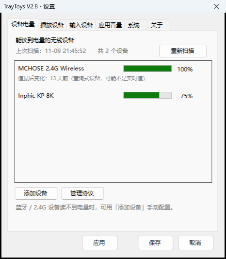
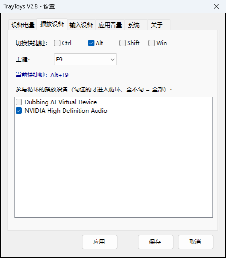
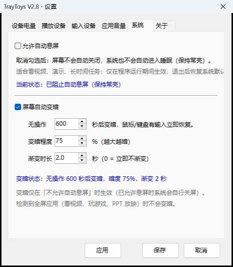

# TrayToys

**一个 124 KB 的单文件托盘工具：按一次热键切换音频设备，顺便管住音量、电量和屏幕。**

<p>
  
  
  
  
  
</p>

[功能](#功能一览) · [截图](#截图) · [下载](#下载) · [从源码构建](#从源码构建) · [配置说明](#配置与日志都在-exe-同目录) · [更新日志](CHANGELOG.md) · [English](#english)



四件事，一个 exe，没有安装程序、没有后台服务、不联网：

| | 功能 | 一句话 |
|---|---|---|
| 🔊 | **音频设备快切** | 全局热键循环切换播放 / 输入设备，右下角浮窗提示（不可聚焦、2 秒自动消失） |
| 🎚 | **按应用调音量** | 等价于 Windows 音量合成器，但应用关掉再打开，音量自动回到 100% |
| 🔋 | **无线设备电量** | 蓝牙走系统 PnP 属性，2.4G 私有协议走 HID 报告；读不到的可用向导自己配 |
| 🌙 | **防息屏 + 屏幕变暗** | 阻止自动息屏；也可以无操作 N 秒后渐进变暗，鼠标键盘一动立即恢复 |

## English

A 124 KB single-file tray toolbox for Windows — C# / .NET Framework 4.8 / WinForms.
No installer, no background service, no telemetry.

- **Cycle audio devices** with a global hotkey (playback and recording bound separately), with a
  non-focusable toast that dismisses itself after 2 s.
- **Per-app volume** — like the Windows volume mixer, plus one extra rule: when an app is closed
  and reopened, its volume is reset to 100 %.
- **Wireless battery levels** — Bluetooth devices via PnP properties, 2.4 GHz proprietary devices
  via HID reports (protocol table is editable from the UI, nothing hardcoded).
- **Keep awake & screen dimming** — block sleep / screen-off, or dim the screen gradually after
  N idle seconds and restore on any input (fullscreen apps such as video players are skipped).

This repository contains **source only**; the compiled exe is attached to each release.
Build with `build.bat` — it uses the `csc` that ships with Windows, so no Visual Studio or SDK
is required.

## 截图

| 播放设备 | 系统（防息屏 / 变暗） |
|---|---|
|  |  |

切换设备时右下角弹出的浮窗（不可聚焦、2 秒自动关闭）：


## 下载

从 [Releases](https://github.com/q1054770491/TrayToys/releases) 下载 `TrayToys_v2.9.exe`，
**单文件、免安装**，放到任意目录双击即可运行。配置与日志都写在 exe 同目录，
不想要了直接删掉整个文件夹就是干净卸载。

## 快速开始

1. 双击运行 —— 首次会弹出设置窗口，此时**还没有绑定任何快捷键**。
2. 在「播放设备」页勾选修饰键（`Ctrl` / `Alt` / `Shift` / `Win`）并选一个主键，点「保存」。
3. 之后按这个快捷键，播放设备就在你勾选过的设备之间循环，右下角浮窗提示当前设备。
4. 想再改：右键托盘图标 →「设置…」。想退出：右键托盘 →「退出」。

> 主键选「无」= 不注册该热键。`Win` 组合容易撞系统快捷键，建议优先 `Ctrl` / `Alt` / `Shift`。
>
> 设置窗口底部三个按钮的区别：**应用** = 立即生效但不关窗（适合边改边试）；
> **保存** = 生效并关闭；**取消** = 不保存直接关闭。

## 功能一览

- **两套独立快捷键**：右键托盘 →「设置...」
  - `播放设备` 页：播放设备切换快捷键；
  - `输入设备` 页：输入设备切换快捷键。
  每页都可勾选 `Ctrl / Alt / Shift / Win` 修饰键并选主键；**主键选「无」= 不注册该热键**。
- **自定义循环范围**：每页勾选「参与循环的设备」——**只有勾选的设备才会进入切换循环**（全不勾 = 全部设备参与）。
- **循环切换**：按快捷键切到下一个勾选设备（同时覆盖 控制台/多媒体/通信 三种音频角色，确保全局生效）。
- **不可聚焦的 2 秒浮窗**：`WS_EX_NOACTIVATE | WS_EX_TOOLWINDOW`，点不中、不进任务栏与 `Alt+Tab`，淡入淡出后自动关闭。播放提示「已切换到：XX」，输入提示「输入设备已切换为：XX」。
- **防息屏开关**（`系统` 页）：取消「允许自动息屏」后，屏幕不会自动关闭、系统不会自动睡眠（**V1.7 起首次启动默认已关闭该项**）。
- **屏幕自动变暗**（`系统` 页）：防息屏期间的省电/护眼补充 —— 无操作 N 秒后**渐变**压暗屏幕，鼠标/键盘一有输入立即**渐变**恢复；等待秒数、变暗程度、渐变时长都可自设（**首次启动默认 300 秒 / 75% / 1 秒**）。
- **看视频不会被误变暗**：检测到全屏应用（视频/游戏/PPT 放映）时暂停变暗，退出全屏后自动恢复判定。
- **应用音量**（`应用音量` 页）：列出所有出声 / 已暂停的应用，单独调音量与静音；**应用关闭后再打开会自动恢复 100%**。
- **设备电量**（`设备电量` 页）：显示能向 Windows 上报电量的无线设备（蓝牙耳机 / 鼠标 / 键盘，以及协议表收录的 2.4G 设备），**每次启动自动扫描**，不写死设备；读不到的设备可点「添加设备」——选设备、填官方电量、自动识别即可（存 `TrayToys.json`，无需改代码）；需要手选接口时用对话框里的「高级自定义…」。
- **开机自启**（`关于` 页）：一个勾选框搞定。判定标准是「快捷方式存在**且指向当前 exe**」——升级换版本后旧快捷方式不会让你登录时跑到旧版本上（会显示为未勾选，勾一下即改指过来）。
- 启动驻留托盘、单实例运行；隐藏主窗口同样不进任务栏与 `Alt+Tab`。

## 应用音量（音量合成器）

设置窗口的「应用音量」页签，等价于 Windows 自带的音量合成器，并额外提供一条自己的规则。

- 列出所有**有音频会话**的应用：正在播放的 + 已暂停但还在后台的（后者用灰色字表示）；
- 每行一个应用：程序图标、名称、音量滑块（拖动**即时生效**）、百分比、静音开关；
- 同一个应用的多路会话（例如浏览器多个标签）合并成一行，调节时一起生效；
- 顶部显示「当前系统总音量」供对照（注意 Windows 实际响度 = 设备音量 × 应用音量）；
- 「全部恢复到 100%」一键把所有应用拉满并取消静音；
- **应用被关闭后再次打开，音量自动恢复 100%** —— 常驻后台生效，不需要打开设置窗口。

> 为什么需要这条规则：Windows 本身会按「应用 + 设备」记住每个应用的音量，重启时恢复上次的值；本功能在这个基础上把"曾经被关掉过"的应用拉回满音量。
>
> 「暂停播放」不算关闭（会话仍然存在，只是状态从 Active 变 Inactive），只有应用真的退出才会触发重置。
>
> 该规则**只在程序运行期间有效**；程序退出后即回到 Windows 默认行为（记住上次音量）。

## 设备电量

设置窗口的「设备电量」页，显示**能向 Windows 上报电量**的无线设备。

- **每次程序启动自动扫描**一遍（后台线程，不阻塞启动），不需要手工指定任何设备；
- 每行显示设备名、电量条、百分比（≤20% 标红）；
- 页面上有「重新扫描」按钮，新接上设备后点一下即可；
- **只显示当前真的在线的设备**（蓝牙设备的电量属性在断开后不会清空，所以要额外判定）：
  1. 蓝牙设备节点自带 `DN_DEVICE_DISCONNECTED`（`DEVPKEY_Device_DevNodeStatus`）→ 视为已断开，不显示；
  2. 经典蓝牙设备再问一次蓝牙层 `fConnected`（已配对但未连接 → 不显示）；
  3. 其它设备退回"同一个容器里还有没有在线接口"；
- 数据来源有两条路径：
  1. **蓝牙等标准设备**：PnP 属性 `DEVPKEY_Device_BatteryLevel` —— 与 Windows「设置 → 蓝牙和其他设备」里显示电量的数据同源；
  2. **2.4G 私有协议设备**：电量夹带在 HID 报告里，按内置协议表（`VID:PID` + 接口 + 字节偏移 + 读取方式）读取。目前收录：**英菲克 KP 8K**（鼠标，Input 报告主动上报）、**MCHOSE 键盘**（Feature 报告查询式）。

> **局限由设备决定，不是程序问题**：
> - 部分蓝牙耳机、TWS 耳机即使出现，读数也可能来自其免提（Hands-Free）节点，未必精确到个位数；
> - 2.4G 设备能否读到，取决于是否被协议表收录（协议需逐个设备实测反推）；未收录的不会出现在列表里；
> - **查询式（Feature）2.4G 设备在设备关机后仍可能显示上次的读数**：接收器用缓存应答，程序无法分辨真伪（V2.6 已定：暂不处理，只给「值最后变化：X 前」提示）。

### 自己添加新设备（2.4G）

2.4G 设备的协议是厂商私有的。读不到电量时点「添加设备」，**只需要三步**：

1. **选设备** —— 下拉框按「物理设备」合并显示（同一个设备的 4 个接口只占一条），不需要理解"接口"是什么；
2. **填官方电量** —— 厂商软件里显示多少就填多少（例如 100），点「**自动识别**」；
3. **确认结果** —— 程序会把该设备的**所有接口、所有可读报告、每个字节**都试一遍，列出所有"值等于该电量"的位置：
   - **只有 1 个候选** → 自动选中，直接保存；
   - **多个候选**（满电时很常见，好几个字节都是 100）→ 在列表里选一个；判断不出来时按提示改动一项无关设置（如键盘背光亮度）再识别一次，**跟着变的那一项就不是电量**；
   - **0 个候选** → 按提示确认官方读数是否正确、先动一下设备（让它上报一次）再试。

识别耗时通常 2~3 秒（带进度条，可随时取消）。保存后写入 `TrayToys.json`，「设备电量」页立即生效。

> **高级自定义**：设备情况特殊时（要手选接口 / 看原始报文 / 逐字节确认），点对话框左下角的「**高级自定义…**」—— 就是原来的 4 步向导：
> 选接口 → 读报文（Feature 的 ReportID 自动探测）→ 自动搜索字节（遍历所有 ReportID × 所有字节）→ 测试并保存。报文区可切换十六进制 / 十进制，也能直接点字节框手动选。

配置保存在 exe 同目录的 **`TrayToys.json`** 里的 `hidProtocols` 字段（**和快捷键等配置同一个文件**，不再单独占文件）：

```json
"hidProtocols": [
  {"vid":7511,"pid":64101,"usagePage":10,"useFeature":false,
   "featureReportId":0,"batteryByte":4,"name":"英菲克 KP 8K"},
  {"vid":16868,"pid":8193,"usagePage":65284,"useFeature":true,
   "featureReportId":6,"batteryByte":3,"name":"MCHOSE 键盘"}
]
```

> - `vid` / `pid` / `usagePage` 都是**十进制**（例：`7511` = 0x1D57）；
> - `batteryByte` 从 **0** 开始（0 = 第 1 个字节，通常该字节是 ReportID，所以电量一般在 1 以后）；
> - 配错了可以点「管理协议」删除对应条目，删完会自动重新扫描；
> - **`hidProtocols` 出厂默认为空**：代码里不预设任何具体设备（把软件发给别人时，配置里不会出现对方没有的设备名）；需要识别某个设备时用「添加设备」向导配一次即可，之后一直保存在 `TrayToys.json` 里。

### 相关诊断命令

```bat
TrayToys_v2.9.exe --test-identify 41E4 100  :: 智能识别：按设备合并接口、自动遍历全部接口，输出所有候选与耗时
TrayToys_v2.9.exe --test-simpledevice     :: 打开简化版「添加设备」并自绘截图（验证布局）
TrayToys_v2.9.exe --test-probe          :: 列出所有可配置接口、自动探测 Feature ReportID、读一次 Input 报告
TrayToys_v2.9.exe --test-autosearch 41E4 100  :: 自动搜索：在指定接口上找值等于 100 的字节（高级模式用）
TrayToys_v2.9.exe --test-batterysetup   :: 打开「高级自定义」4 步向导并自绘截图（验证布局）
TrayToys_v2.9.exe --test-saveconfig     :: 调用一次配置保存，检查 TrayToys.json 里 hidProtocols 的格式
TrayToys_v2.9.exe --test-btdump         :: 原样打印每个带电量属性的设备节点（InstanceId / 容器在线与否 / DevNodeStatus / 蓝牙连接状态），排查"该显示却没显示 / 该消失却没消失"
```

## 开机自启

**构建不会自动改启动项**。想让它在开机时自动运行，两种方式都行：

1. **设置窗口 → 「关于」页右下角的「开机启动」勾选框** —— 勾上就建好，取消就删掉；
2. **双击 `create-startup-shortcut.bat`** —— 适合命令行/批处理场景，自动挑 `bin\` 里**版本号最高**的 exe。

两者写的是同一个快捷方式，都在：

```
%APPDATA%\Microsoft\Windows\Start Menu\Programs\Startup\TrayToys.lnk
```

- 要指定某个 exe（比如放在别的盘）：
  ```
  create-startup-shortcut.bat "D:\Tools\TrayToys_v2.9.exe"
  ```
  或者直接调底层脚本：
  ```
  powershell -NoProfile -ExecutionPolicy Bypass -File set-startup-shortcut.ps1 -ExePath "D:\Tools\TrayToys_v2.9.exe"
  ```
- **为什么不再跟构建绑定**：以前每次构建都会把启动项改指到新 exe —— 你只是想编一个测试版，登录时跑的就悄悄换掉了。现在升级后想让它自启，再跑一次这个脚本就行。
- **不想开机自启**：删掉那个 `TrayToys.lnk` 就行，程序本身不受影响。

## 配置与日志（都在 exe 同目录）

- **配置文件**：`TrayToys.json`（首次运行自动生成），内容示例：
  ```json
  {
    "modifiers": 3, "key": 0,
    "selectedDevices": ["{播放设备Id1}", "{播放设备Id2}"],
    "inputModifiers": 3, "inputKey": 77,
    "selectedInputDevices": ["{输入设备Id1}"],
    "toastMs": 2000, "logEnabled": false, "allowScreenOff": false,
    "dimEnabled": true, "dimSeconds": 300, "dimOpacity": 75, "dimFadeSec": 1
  }
  ```
  - `modifiers` / `key`：**播放设备**快捷键；`inputModifiers` / `inputKey`：**输入设备**快捷键。
  - `key`（或 `inputKey`）为 **`0` 表示「无」**，即不注册该热键；位掩码 Ctrl=2, Alt=1, Shift=4, Win=8；键码 83=S, 120=F9, 77=M。
  - **首次生成的配置里 `key` 与 `inputKey` 均为 `0`（无）**，需在设置界面选择主键后才会注册热键。
  - `selectedDevices` / `selectedInputDevices`：参与循环的设备 Id 列表；`null` 或空数组 = 全部设备。也可直接在设置界面勾选。
  - `allowScreenOff`：`false` = 阻止屏幕关闭与系统睡眠（**首次启动默认**）；`true` = 允许自动息屏（旧配置缺该字段时按此处理）。对应设置页「系统」页签的勾选框。
  - `dimEnabled`：是否启用屏幕自动变暗（**首次启动默认 `true`**；旧配置缺该字段时按 `false` 处理）。
  - `dimSeconds`：无操作多少秒后变暗（5~3600，首次启动默认 300，缺省 60）。
  - `dimOpacity`：变暗程度百分比（20~95，首次启动默认 75，缺省 70，越大越暗）。
  - `dimFadeSec`：变暗/恢复的**渐变时长**（秒，0~5，首次启动默认 1，缺省 0.4；`0` = 不做渐变，立即切换）。旧版毫秒字段 `dimFadeMs` 会被自动换算（如 2000 → 2 秒）。
  - 变暗**只在 `allowScreenOff` 为 `false` 时生效**。
- **运行日志（默认关闭）**：`TrayToys.log`。**默认不生成任何日志**，需要排查问题时才在「关于」页勾选「记录日志」；开启后记录启动、快捷键注册、设备切换与所有异常（含完整堆栈，超过 2MB 自动轮转）。
  - 「删除日志文件」按钮（同在「关于」页）可清空已有日志；**右键托盘「打开日志文件」**可一键打开（未开启时会提示）。
- **崩溃记录（始终开启）**：`TrayToys_crash.log`。程序遇到未捕获异常（无论 UI 线程还是后台线程）时，会把**完整堆栈强制写入**该文件，**不受「记录日志」开关影响** —— 这样即使平时没开日志，崩溃也有据可查。同时会弹一次提示框（同一个错误 5 秒内只弹一次，避免刷屏）。遇到"程序突然自己消失了"，把这个文件发给开发者即可定位。

## 从源码构建

方式一（最快，无需任何工具链）：双击 `build.bat`。
方式二：用 **Visual Studio 2019/2022** 打开 `TrayToys.sln`，生成解决方案。
方式三（Git Bash）：`bash build.sh`。

产物命名规则：**`bin\TrayToys_v<版本号>.exe`**，版本号自动从 `src\AppInfo.cs` 读取。

### 版本号规则（维护者）

- **日常改代码不要动版本号**，继续沿用当前已发布的版本号；
- **只有明确「发布新版本」时才升版本号**，一条命令完成「升版本 → 构建 → 归档源码」：

```bash
# 发布新版本（推荐）
bash release.sh 2.9 "本次版本说明"

# 只给当前版本补一份源码存档（不升版本、不构建）
bash release.sh archive
```

`release.sh` 会依次做：

1. 把 `src\AppInfo.cs` 与 `src\AssemblyInfo.cs` 的版本号改为新版本；
2. 调用 `build.sh` 构建 `bin\TrayToys_v<新版本>.exe`（**构建失败会自动回滚版本号**）；
3. 把该版本的**完整快照**封存到 `archive\v<新版本>\`——含 `src\*.cs`、**该版本的 exe**、`csproj`/`sln`、`build.sh`/`build.bat`、`set-startup-shortcut.ps1`/`create-startup-shortcut.bat`、`README.md`，以及记录版本号/归档时间/说明的 `RELEASE.txt`。

> 归档目录是完整快照（源码 + exe）：既可以直接取用其中的 `TrayToys_vX.Y.exe`，也可以 `cd archive/vX.Y && bash build.sh` 从源码重新构建。
> `archive\` 已在 `TrayToys.csproj` 里用 `<Compile Remove="archive\**" />` 排除，不会参与编译；
> 同时它在 `.gitignore` 里 —— 归档只留在本地，不进仓库（成品 exe 走 Releases）。
> 重新归档同一个版本时会保留原来的「版本说明」，只有源码和 exe 被刷新。

> 构建用的是 Windows 自带的 .NET Framework 编译器（csc），不依赖 NuGet / MSBuild 安装。
> 各版本 exe 与 `TrayToys.json`、`TrayToys.log` 同目录，配置与日志在各版本间共用。

## 项目结构

```
TrayToys/
├── src/                       # 源码（按职责拆分，25 个 .cs）
│   ├── Program.cs             # 入口：单实例、全局异常兜底、诊断模式
│   ├── MainForm.cs            # 隐藏主窗体：双快捷键、托盘、设备循环切换
│   ├── SettingsForm.cs        # 设置窗口（页签：设备电量 / 播放设备 / 输入设备 / 应用音量 / 系统 / 关于）
│   ├── ToastForm.cs           # 不可聚焦、2 秒自动关闭的浮窗
│   ├── AudioManager.cs        # Core Audio COM：枚举/切换播放与输入设备
│   ├── AudioSessionManager.cs # Core Audio 会话：枚举应用音量 / 静音（音量合成器）
│   ├── SessionRow.cs          # 「应用音量」页的一行（图标 + 滑块 + 静音）
│   ├── SessionResetKeeper.cs  # 常驻：应用关闭后重开时把音量恢复 100%
│   ├── DeviceBatteryManager.cs # 扫描能读到电量的无线设备（蓝牙 DEVPKEY + 2.4G HID 协议表）
│   ├── BatteryProtocols.cs     # 2.4G 协议表的模型与持久化（存在 TrayToys.json 的 hidProtocols 字段）
│   ├── DeviceSetupSimpleForm.cs # 「添加设备」简化界面（选设备→填官方电量→自动识别→保存）
│   ├── BatterySetupForm.cs     # 「高级自定义」4 步向导（选接口→读报文→自动搜索字节→测试保存）
│   ├── ProtocolManageForm.cs   # 「管理协议」列表（查看 / 删除已配置项）
│   ├── ScreenKeeper.cs        # 防息屏（SetThreadExecutionState）
│   ├── ScreenDimmer.cs        # 屏幕变暗控制（空闲检测 + 遮罩管理 + 指针隐藏）
│   ├── FullscreenWatcher.cs   # 全屏应用检测（看视频/游戏时暂停变暗）
│   ├── DimForm.cs             # 变暗遮罩窗（全屏半透明黑，不抢焦点，隐藏指针）
│   ├── NativeMethods.cs       # Win32：RegisterHotKey / GetLastInputInfo 等
│   ├── Settings.cs            # 配置读写（TrayToys.json）
│   ├── HotkeyKeys.cs          # 虚拟键码与显示名映射
│   ├── TrayIconHelper.cs      # 运行时绘制托盘图标
│   ├── Logger.cs              # 文件日志 TrayToys.log / TrayToys_crash.log（默认关闭）
│   ├── AutoStart.cs           # 开机自启：读写「启动」文件夹里的 .lnk（WScript.Shell 后期绑定，无 COM 引用）
│   ├── AppInfo.cs             # 版本号 / 程序名（改这里即可发新版本）
│   └── AssemblyInfo.cs        # 程序集版本信息（V2.9.0.0）
├── docs/images/               # README 里用到的截图
├── TrayToys.sln               # Visual Studio 解决方案（双击即可用 VS 打开）
├── TrayToys.csproj            # 项目文件（.NET Framework 4.8 / WinForms）
├── build.bat                  # 一键构建（cmd 版，用系统自带 csc，无需装 VS/SDK）
├── build.sh                   # 一键构建（Git Bash 版）
├── release.sh                 # 发布脚本：升版本号 → 构建 → 归档该版本源码
├── set-startup-shortcut.ps1   # 建启动项快捷方式的底层脚本（可传 -ExePath 指定 exe）
├── create-startup-shortcut.bat # 双击即可：自动挑 bin 里最新版本建启动项（与构建无关）
├── CHANGELOG.md               # 版本历史（V1.1 → 当前）
├── README.md
├── LICENSE                    # MIT
├── .gitignore / .gitattributes
├── bin/                       # 构建产物（**已被 git 忽略**；每个版本一个独立 exe）
└── archive/                   # 本地历史版本快照（**已被 git 忽略**；不参与编译）
```

> 仓库里只有**源码 + 脚本 + 文档**。`bin/`（exe、配置、日志）和 `archive/`（历史快照）
> 都在 `.gitignore` 里 —— 前者含本机信息（音频设备 GUID、2.4G 协议表、电量时间戳），
> 后者是几个 MB 的旧 exe，对使用者没有价值。成品 exe 走 Releases。

## 排错

- 切换默认设备一般不需要管理员权限；个别机器无效时，右键 exe「以管理员身份运行」再试（`IPolicyConfig` 是非公开 COM 接口）。
- `Win` 作修饰符可能撞系统快捷键，建议优先 `Ctrl / Alt / Shift` 组合。
- 快捷键注册失败（被占用）会弹警告（并写入日志，若日志已开启），换个组合即可。
- 诊断命令：
  - `TrayToys_v2.9.exe --selftest`：验证浮窗可正常创建（退出码 0 = 通过）。
  - `TrayToys_v2.9.exe --test-list`：枚举并记录播放/输入设备（写入 TrayToys.log）。
  - `TrayToys_v2.9.exe --test-sessions`：枚举所有应用音频会话（音量合成器那套）。
  - `TrayToys_v2.9.exe --test-settings [页签序号]`：直接打开设置窗口用于界面检查。
  - `TrayToys_v2.9.exe --test-crash`：在后台线程故意抛一个未捕获异常，验证崩溃记录 `TrayToys_crash.log` 能正确落盘（进程会随之退出，属预期）。
  - `TrayToys_v2.9.exe --test-perf`：性能自检，打印 `GetSessions` / 全屏检测 / 设备总音量读取的单次耗时，并折算成常驻 CPU 开销（改动高频路径后用它做回归）。
  - `TrayToys_v2.9.exe --test-toastshot <png>`：把切换提示浮窗渲染成图片（README 里那张浮窗图就是这么来的，不切换任何设备）。
- 屏幕变暗相关：
  - 变暗与恢复都是**渐变**的，时长由「渐变时长」控制（单位秒，默认 0.4 秒，设 0 则不做渐变）。
  - 暗屏期间**鼠标指针会一起隐藏**（系统指针画在所有窗口之上，不受透明度影响，遮不住），**一有输入立即恢复显示**。
  - **看视频/玩游戏/PPT 放映时不会变暗**（检测到全屏应用即暂停变暗）；注意遮罩显示期间系统会认为"有全屏应用"，第三方通知此时不会弹出。
  - 若某个播放器的"全屏"是**无边框窗口化**（并非真全屏），可能不被识别为全屏应用 —— 这种情况改用播放器真正的全屏模式即可。
  - 变暗期间**点击鼠标不会穿透到下层窗口**（避免误操作），这一下点击本身即用于唤醒，屏幕随即渐显恢复。
  - 键盘输入会先触发恢复；若担心暗屏期间按键被前台窗口接收，请在按钮/输入框之外先动一下鼠标。
  - 多显示器会一次性全部压暗；程序退出或设置变更时立即撤销变暗。


## 更新日志

完整版本历史（V1.1 → V2.9，含每个版本的改动、取舍与踩过的坑）见 **[CHANGELOG.md](CHANGELOG.md)**。

## 许可证

[MIT](LICENSE) © 2026 q1054770491
